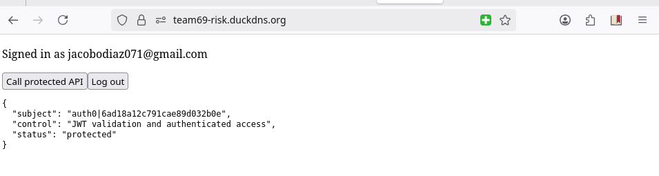
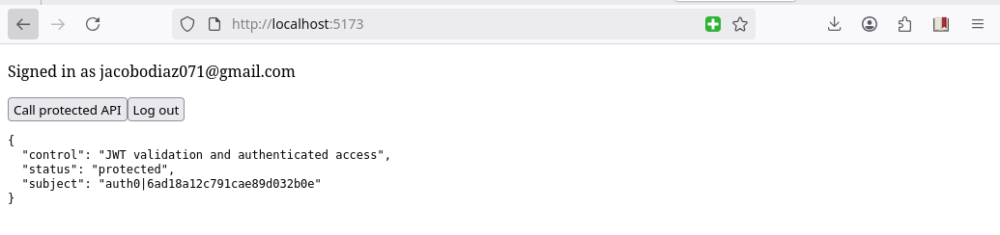
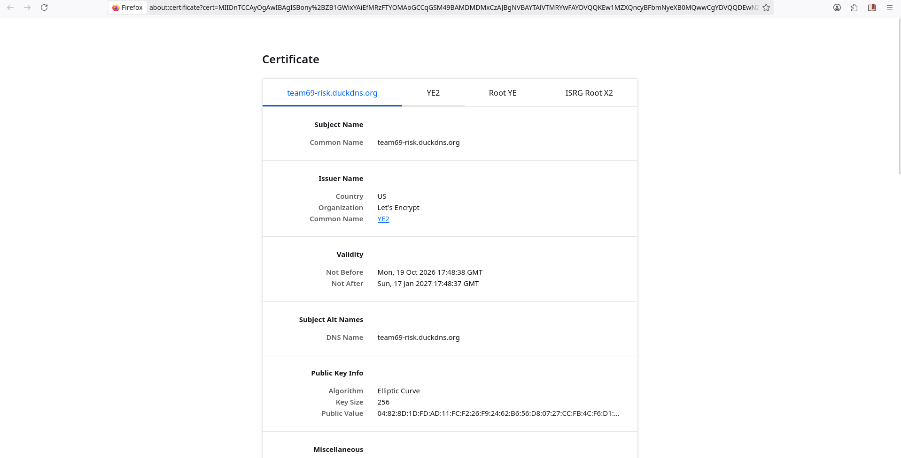
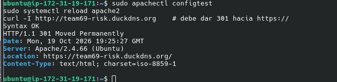
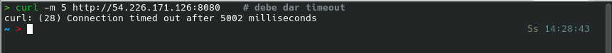
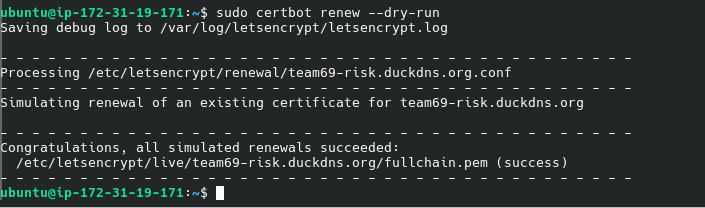

# Secure Web System as an Enterprise Risk Control

**Autor:** *Jacobo Diaz Alvardo*
---
Sistema web con frontend React, autenticación con Auth0 y un backend Spring Boot protegido como OAuth 2.0 Resource Server, desplegado en AWS detrás de Apache con HTTPS.

**URL desplegada:** https://team69-risk.duckdns.org

## Arquitectura

```
Navegador
  │ login y access token
  ▼
Auth0 ───────────────► Frontend React ── Bearer token ──► Spring Boot API
                                                             │ (127.0.0.1:8080)
Internet ── Duck DNS ── Apache + TLS (80/443) ───────────────┘
```

| Componente | Tecnología |
|---|---|
| Frontend | React (Vite) + `@auth0/auth0-react` |
| Identidad | Auth0 (SPA + API con audience `https://enterprise-risk-api`) |
| Backend | Spring Boot (Java 21, Maven), Spring Security, OAuth2 Resource Server, Actuator |
| Servidor | AWS EC2, Ubuntu |
| Proxy y TLS | Apache HTTP Server + certificado Let's Encrypt (Certbot) |
| Dominio | Duck DNS |
| Servicio | systemd (`enterprise-risk-api.service`) |

## Estructura del repositorio

```
frontend/   Aplicación React
backend/    API Spring Boot
img/        Evidencias (capturas)
README.md
```

---

## Proceso realizado

### 1. Configuración de Auth0

1. Creé la **API** `Enterprise Risk Lab API` con identifier (audience) `https://enterprise-risk-api` y firma RS256.
2. Definí el permiso `read:risk` en esa API.
3. Creé la **Single Page Application** `Enterprise Risk Lab Frontend`, con *Callback*, *Logout* y *Web Origins* para `http://localhost:5173` y para la URL HTTPS, sin comodines.
4. Concedí a la SPA **User-Delegated Access** sobre la API con el permiso `read:risk`.
5. Creé un usuario de prueba en la conexión `Username-Password-Authentication`.

### 2. Backend Spring Boot

- Proyecto con Spring Web, Spring Security, OAuth2 Resource Server y **Actuator** (el documento original no lo incluía, pero `/actuator/health` lo necesita).
- `SecurityConfig`: `/actuator/health` público, `/api/**` autenticado, todo lo demás denegado, y CORS limitado a los orígenes exactos.
- `application.properties`: `issuer-uri` de Auth0 (con `https://` y `/` final) y `audiences` igual al identifier de la API.
- `RiskController` con el endpoint `GET /api/risk-status`.
- Prueba local: sin token responde `401`.

### 3. Frontend React

- Proyecto Vite con `Auth0Provider` (domain, clientId y audience desde `.env.local`, que no se versiona).
- `App.jsx`: login con redirección, `getAccessTokenSilently()` y llamada a la API con `Authorization: Bearer <token>`. Se añadió `isLoading` para evitar el parpadeo del botón de login.
- Prueba local completa de login y llamada a la API.

### 4. Servidor y Duck DNS

- Instancia EC2 con Ubuntu, security group con TCP 22 (solo mi IP), 80 y 443. El 8080 no se abre.
- Firewall `ufw` activo (22, 80, 443).
- Subdominio `team69-risk.duckdns.org` apuntando a la IP pública de la instancia.
- Instalación de `apache2`, `certbot`, `python3-certbot-apache` y `openjdk-21-jre`.
- Compilación en mi equipo (`./mvnw clean package` y `npm run build` con `VITE_API_URL` apuntando a la URL HTTPS) y copia al servidor con `scp`.

### 5. Despliegue del backend

- JAR en `/opt/enterprise-risk-api/` con un usuario de sistema sin shell (`riskapi`).
- Servicio systemd con `SERVER_ADDRESS=127.0.0.1`, límite de memoria y endurecimiento básico (`NoNewPrivileges`, `PrivateTmp`).
- Verificación: `/actuator/health` responde `UP` y `ss -tlnp` muestra el puerto 8080 escuchando solo en `127.0.0.1`.
- Los logs se consultan con `journalctl -u enterprise-risk-api`.

### 6. Apache y HTTPS

- Frontend copiado a `/var/www/enterprise-risk-frontend`, con reescritura a `index.html` para las rutas de la SPA.
- Reverse proxy de `/api/` hacia `http://127.0.0.1:8080/api/`.
- Certificado emitido con `certbot --apache`.
- Corregí `X-Forwarded-Proto` a `"https"` en el VirtualHost 443, porque Certbot copia el valor `"http"` del bloque del puerto 80.
- El VirtualHost del puerto 80 quedó solo como redirección permanente (`301`) hacia HTTPS.
- Se actualizaron en Auth0 las URLs de callback, logout y web origins con la dirección HTTPS.
- `certbot renew --dry-run` exitoso.

### 7. Verificación

- [x] Sin token, `/api/risk-status` devuelve `401`.
- [x] Un usuario autenticado llama a la API desde el frontend.
- [x] El backend valida issuer y audience.
- [x] La aplicación está disponible en `https://team69-risk.duckdns.org`.
- [x] El navegador muestra un certificado válido de Let's Encrypt.
- [x] El puerto 8080 no es accesible desde Internet.
- [x] `sudo certbot renew --dry-run` termina bien.

---

## Evidencias

**Llamada autenticada exitosa en el sistema desplegado (HTTPS)**



**Flujo de login y llamada en local**



**Certificado válido**



**HTTP redirige a HTTPS (301)**



**El puerto 8080 no es público (timeout)**



**Renovación automática del certificado (dry-run)**



---

## Reflexión de riesgos

| Control | Riesgo reducido | Evidencia |
|---|---|---|
| Autenticación con Auth0 | Suplantación y mal manejo de credenciales | Login con Auth0 e identidad del usuario (`api-https.png`) |
| Validación del JWT en la API | Acceso no autorizado a la API | `401` sin token válido |
| Validación del audience | Reutilizar un token emitido para otra API | La API solo acepta `https://enterprise-risk-api` |
| HTTPS con certificado válido | Exposición de credenciales o tokens en tránsito | `candado.png`, `301.png` |
| Reverse proxy con Apache | Exposición directa del puerto de la aplicación | Solo 80 y 443 públicos, `timeout.png` |
| Logs centralizados (journalctl) | Investigación tardía de incidentes | Salida de `journalctl -u enterprise-risk-api` |

---

## Conceptos que aprendí

### Auth0
Plataforma de **identidad como servicio**: se encarga del registro, el login y la emisión de tokens, así que la aplicación no guarda ni maneja contraseñas. Es la primera vez que la uso. Auth0 autentica al usuario y entrega un *access token* (JWT) que el backend valida.
**Cuándo usarla:** cuando una aplicación necesita login seguro (usuarios propios, redes sociales, SSO empresarial) sin construir ni mantener un sistema de autenticación propio, que es una zona de alto riesgo.

### Autenticación vs. autorización
- **Autenticación:** ¿quién eres? La resuelve Auth0.
- **Autorización:** ¿qué puedes hacer? La definen el *audience* y los permisos (`read:risk`).

### JWT y Resource Server
El backend no autentica a nadie: **valida el token** (firma, issuer, audience y vigencia). Si algo no cuadra, responde `401`. Esto permite una API *stateless*, sin sesiones propias.

### Duck DNS
**Qué es:** servicio gratuito de DNS dinámico que permite asignar un nombre de dominio a una dirección IP pública que puede cambiar con el tiempo.
**Cuándo se usa:** cuando quiero conectarme a un servidor remoto cuya IP cambia cada cierto tiempo. Permite crear un dominio como `miservidor.duckdns.org` que apunta a la IP pública.
**Casos de uso:**
- **Acceso remoto:** conectarse a un servidor mediante SSH.
- **Laboratorios de ciberseguridad:** publicar servicios de prueba accesibles desde Internet.
- **Self-hosting:** alojar una página web, una API o servicios personales en casa.
- **VPN:** acceder a la red doméstica mediante WireGuard u otra solución.

En este lab, además, me dio el nombre de dominio que Let's Encrypt necesita para emitir el certificado.

### Let's Encrypt y Certbot
Let's Encrypt es una autoridad certificadora gratuita y Certbot automatiza la emisión y la renovación. Valida que controlo el dominio llegando al puerto 80, por eso ese puerto debe estar abierto. Los certificados duran unos 90 días, así que probar la renovación (`renew --dry-run`) es parte del despliegue.

### Apache como reverse proxy
Apache es la única puerta pública: sirve el frontend, termina el TLS y reenvía `/api/` al backend local. Así el puerto 8080 no se expone y se **reduce la superficie de ataque**.

### systemd
Ejecuta el JAR como servicio: arranca solo, se reinicia si falla, corre con un usuario sin privilegios y deja sus logs en `journalctl`.

### AWS EC2 y security groups
La instancia tiene IP pública real, y el *security group* actúa como firewall externo. Aprendí que en AWS hay dos capas (security group y `ufw` en el servidor) y que ambas deben permitir el tráfico.

### ¿Por qué Ubuntu y no Amazon Linux?
Porque todo el laboratorio está escrito para el ecosistema **Debian/Ubuntu**:
- Los paquetes se instalan con `apt` (`apache2`, `python3-certbot-apache`, `openjdk-21-jre`), mientras que Amazon Linux usa `dnf` y otros nombres de paquete.
- En Ubuntu Apache se llama `apache2` y sus archivos viven en `/etc/apache2/`. En Amazon Linux se llama `httpd` y usa `/etc/httpd/`.
- Los comandos `a2enmod`, `a2ensite` y `apache2ctl` son propios de Debian/Ubuntu y no existen en Amazon Linux.
- El plugin de Certbot para Apache está empaquetado y documentado para Ubuntu, lo que simplifica la emisión del certificado.

Amazon Linux es una buena opción dentro de AWS, pero habría obligado a traducir los comandos del lab. Ubuntu permitió seguir las instrucciones tal cual.

---

## Notas de seguridad

- No se versionan `.env.local`, llaves `.pem`, tokens de Duck DNS ni secretos de Auth0.
- La SPA usa solo el Client ID; nunca un client secret.
- CORS restringido a los orígenes exactos (desarrollo y producción).
- El access token nunca se muestra, no se registra en logs ni se guarda manualmente.
- Cuentas de servidor con mínimo privilegio (`riskapi` sin shell).